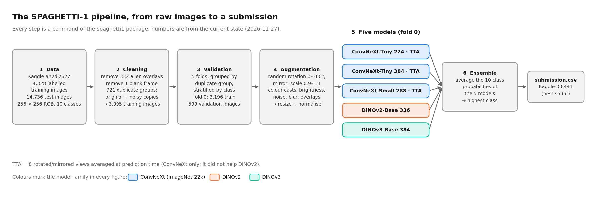

# SPAGHETTI-1 | AN2DL 2026/27 galaxy classification

Classify 256 × 256 RGB galaxy images into 10 classes. Submissions are scored with **weighted F1**. The official data has 4,328 labelled training images and 14,736 test images. [Competition page](https://www.kaggle.com/competitions/an2dl2627)

**Start with [docs/00_START_HERE.md](docs/00_START_HERE.md).** The documentation is numbered 00–13 in reading order. New to machine learning? Start with [docs/12](docs/12_CONCEPTS_EXPLAINED.md), which explains every concept and technique used here, and [docs/13](docs/13_MODEL_ARCHITECTURES.md), which shows the architectures as diagrams.

## Quick start for teammates (Colab)

1. Open [notebooks/01_load_preprocessed_data.ipynb](notebooks/01_load_preprocessed_data.ipynb) in Colab and select a GPU runtime.
2. Paste the Google Drive link of `spaghetti1_clean_v1.zip` into `DATA_SOURCE`.
3. Run all cells. You get verified data and ready DataLoaders:

```python
from spaghetti1.sharing.fetch import prepare_dataset
from spaghetti1.preprocessing.loaders import build_dataloaders

data_dir = prepare_dataset("<Google Drive link>")
loaders = build_dataloaders(data_dir, fold=0, batch_size=64, image_size=224)
```

## Training in the cloud (Google Colab or Kaggle)

Open [notebooks/03_colab_training.ipynb](notebooks/03_colab_training.ipynb) in Colab (or [02_kaggle_training.ipynb](notebooks/02_kaggle_training.ipynb) on Kaggle), choose a plan (for example 5-fold DINOv2), and run it. Results and two zip files (results, weights) are written to your Google Drive. Guide: [docs/11](docs/11_CLOUD_TRAINING.md).

## Local setup

Use Python 3.12 in a virtual environment and run the commands from the repository root.

```bash
python -m pip install -r requirements.txt
cp .env.example .env            # optional: paths, workers, seed (PowerShell: Copy-Item .env.example .env)
```

| Step | Command | Result |
| --- | --- | --- |
| 1 | `python -m spaghetti1 download` | Official data in `data/raw/` (needs a Kaggle token, see [docs/01](docs/01_DATASET_AND_TASK.md)) |
| 2 | `python -m spaghetti1 verify` | CSVs checked against the PNG files |
| 3 | `python -m spaghetti1 eda` | Statistics and plots in `outputs/eda/` |
| 4 | `python -m spaghetti1 preprocess` | `manifests/` (cleaned lists, folds) and review sheets in `outputs/preprocessing/` |
| 5 | `python -m spaghetti1 augment-preview` | Grid of augmented training images |
| 6 | `python -m spaghetti1 export` | `outputs/export/spaghetti1_clean_v1.zip` for Google Drive |
| 7 | `python -m spaghetti1 fetch --source <link or path>` | Downloaded, extracted, and verified package |
| 8 | `python -m spaghetti1 train --config configs/experiments/<name>.env` | Trained model and metrics in `outputs/runs/<name>/` (see [docs/08](docs/08_TRAINING_AND_RESULTS.md)) |
| 9 | `python -m spaghetti1 evaluate --run-dir <run>` | Validation score of saved weights, without retraining |
| 10 | `python -m spaghetti1 predict --run-dirs <run> ... --output-dir <dir>` | `submission.csv` from one model or an ensemble |
| 11 | `python -m spaghetti1 export-weights` / `fetch-weights --source <link>` | Model-weights zip for Google Drive (see [docs/09](docs/09_MODEL_WEIGHTS_AND_REPRODUCTION.md)) |
| 12 | `python -m spaghetti1 export-results` | Lightweight results snapshot in `results/` |

## What the preprocessing found

| Finding | Decision |
| --- | --- |
| 332 training images carry an alien overlay; none in test | Removed |
| 1 blank training frame (2 in test) | Removed from training |
| 721 sky cutouts appear 2–6 times: a clean original plus brightened, noisy copies | Kept in the same CV fold |
| 994 of the 996 copies carry the neighbouring label (2↔3 or 5↔6) | By default, copies are trained with their original's label |
| Test images are corrupted in colour, brightness, noise, and overlays | Training augmentation simulates these corruptions |

Evidence and alternatives: [docs/03_PREPROCESSING.md](docs/03_PREPROCESSING.md).

## Results so far



| Submission | Fold-0 validation | Kaggle public |
| --- | ---: | ---: |
| ConvNeXt Tiny-224 + Tiny-384 + Small-288 | 0.856 | 0.8371 |
| DINOv2-Base 336 alone | 0.851 | 0.8321 |
| DINOv3 ViT-B/16 384 alone | 0.832 | 0.8253 |
| ConvNeXt Tiny-384 + Small-288 + DINOv2 | 0.860 | 0.8424 |
| **3 ConvNeXt + DINOv2 + DINOv3** | 0.855 (test-like 0.861) | **0.8441** |

The best single model is DINOv2 (0.852 on validation). DINOv3 is the most robust to the test images' corruptions. Next: 5-fold training of DINOv2 and DINOv3 in Google Colab.

Details: [docs/08](docs/08_TRAINING_AND_RESULTS.md) (training, all results), [docs/10](docs/10_RESEARCH_REVIEW_AND_PLAN.md) (research review, DINOv2/DINOv3, leaderboard lessons), [docs/09](docs/09_MODEL_WEIGHTS_AND_REPRODUCTION.md) (weights and reproduction without retraining).

## Repository layout

```text
docs/           numbered documentation (00-13), research reports, and figures
manifests/      train/test manifests with flags and CV folds (tracked; identical for everyone)
notebooks/      01_load_preprocessed_data.ipynb (Colab entry point), 02_kaggle_training.ipynb (Kaggle), 03_colab_training.ipynb (Colab)
results/        configs, learning curves, metrics, confusion matrices, submissions of every run
configs/        one .env-format file per experiment + shared recipes (see configs/README.md)
experiments/    GPU temperature guard, cloud queue, ensemble and robustness scripts
spaghetti1/     Python package: ingestion/, eda/, preprocessing/, sharing/, training/, config.py, __main__.py
data/, outputs/ local only, ignored by git
```

`.gitignore` keeps credentials (`.env`, Kaggle tokens), `data/`, and `outputs/` out of git.
