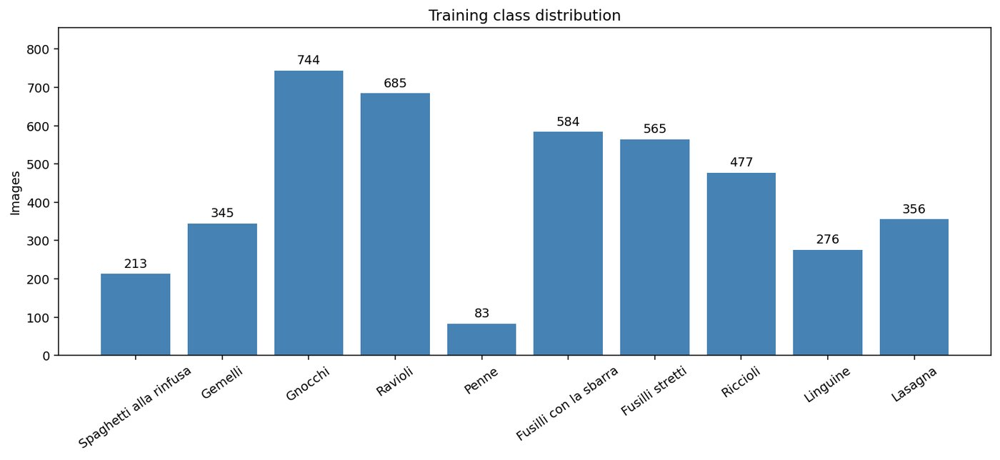
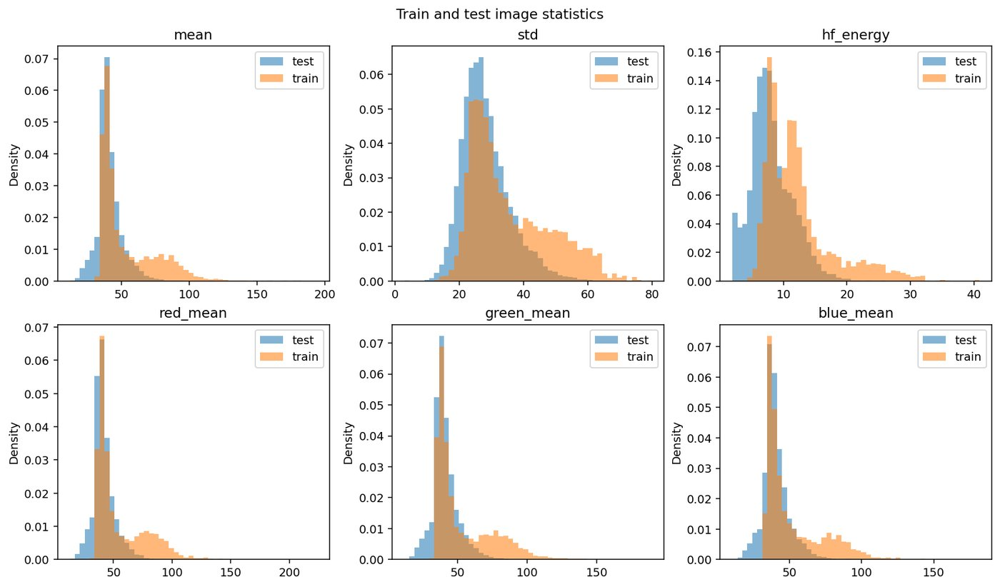
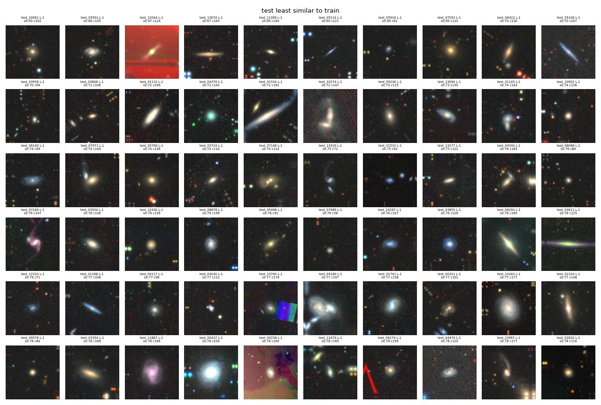

# 02 · EDA findings

Previous: [01 · Dataset and task](01_DATASET_AND_TASK.md) · Next: [03 · Preprocessing](03_PREPROCESSING.md)

The exploratory analysis (`python -m spaghetti1 eda`, code in [spaghetti1/eda/](../spaghetti1/eda/)) read every one of the 19,064 images. It wrote tables and plots to `outputs/eda/`. The follow-up investigation behind [03 · Preprocessing](03_PREPROCESSING.md) added the artifact and duplicate findings below. The original progress report is in [SPAGHETTI-1-Progress-Report.pdf](SPAGHETTI-1-Progress-Report.pdf).

## Format and integrity

| Check | Result |
| --- | --- |
| Images that fail to decode or are not 256 × 256 RGB PNG | 0 of 19,064 |
| Byte-identical files | 0 |
| Near-duplicates (same sky cutout, different noise or colour) | 1,717 training images in 721 groups, and 9 test images matching training images (see 03) |

Byte-identical checks miss the duplicates entirely, because every copy has fresh noise. A dedicated star-field matcher finds them (see 03).

## Class imbalance

Gnocchi is the largest class (744 images, 17.2%) and Penne the smallest (83, 1.9%), a ratio of 9 to 1. After alien removal Penne has only 56 images. That makes it the class most at risk and the main reason to monitor per-class F1.

## Train/test distribution shift

| Mean per-image statistic (0–255 scale) | All train (4,328) | Kept originals and unique (2,999) | Copies (996) | Test (14,736) |
| --- | ---: | ---: | ---: | ---: |
| Brightness | 53.6 | 41.7 | 86.2 | 41.0 |
| Contrast (pixel standard deviation) | 35.9 | 29.3 | 48.7 | 28.3 |
| Neighbour-pixel difference (noise and fine detail) | 12.2 | 9.9 | 20.1 | 8.1 |

At first sight test images look darker and less noisy. The gap is almost entirely caused by the 996 brightened, noisy *copies* in the training set (see 03). Without them, training and test images have nearly the same brightness and contrast. The remaining differences are per-image colour and brightness corruptions in the test set, which the augmentation simulates.

## Artifacts

| Artifact | Where | Notes |
| --- | --- | --- |
| Alien face overlay | 332 training images (7.7%), 0 test | About 33 per class: not linked to the label |
| Blank grey frame | 1 training, 2 test | No object at all |
| Brightened, noisy copies | 996 training images | Copies of other training images with the neighbouring label (see 03) |
| Colour casts (purple, green, red/blue mixing) | Many test images, a few training images | Matching train/test duplicates showed per-channel gains of 0.47–1.23 |
| Colour floods, coloured rectangles, line streaks, read-out bands | Test (and a few training images) | Simulated by the training augmentation (see 05) |

Test images least similar to any training image show these artifacts:

## How the findings shaped the plan

1. Alien overlays are absent from the test set and unrelated to the label, so they are removed rather than learned.
2. Duplicates force group-aware cross-validation. Random splits would put copies of one galaxy on both sides.
3. The test corruptions are mostly photometric (brightness, colour, noise, overlays), so augmentation simulates them. Geometry is randomised fully, because morphology does not depend on orientation.
4. Strong imbalance and a weighted-F1 metric call for class-weighted loss or balanced sampling, chosen by validation.
