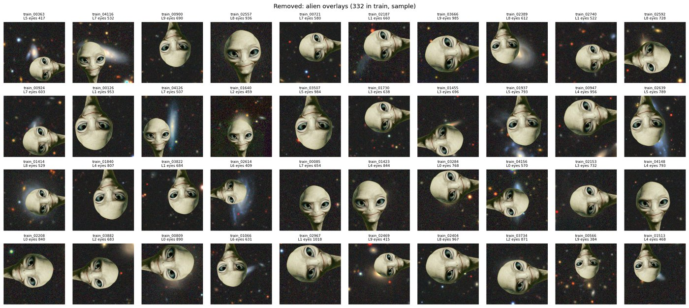
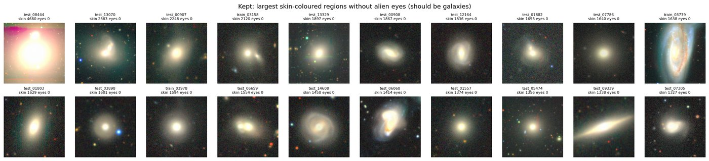
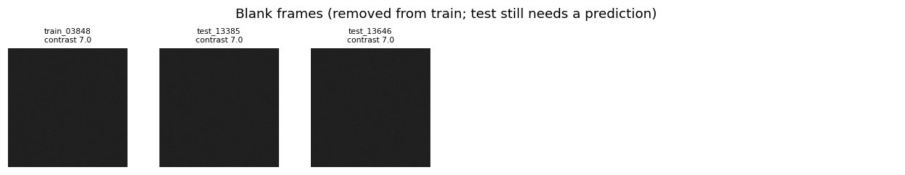
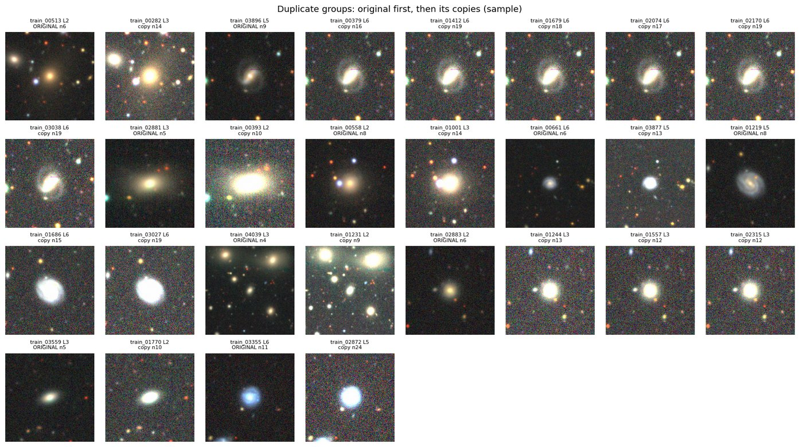
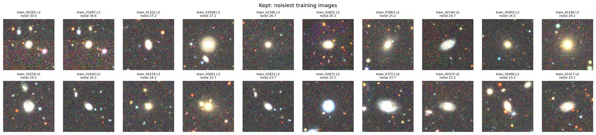
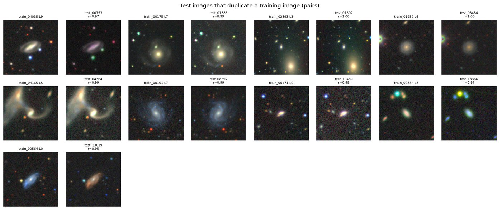

# 03 · Preprocessing (cleaning, duplicates, and labels)

Previous: [02 · EDA findings](02_EDA_FINDINGS.md) · Next: [04 · Manifests and folds](04_MANIFESTS_AND_FOLDS.md)

Command: `python -m spaghetti1 preprocess` (about 4.5 minutes for 19,064 images). Code: [spaghetti1/preprocessing/](../spaghetti1/preprocessing/), read in this order: `quality.py` → `duplicates.py` → `manifest.py`.

The step **does not modify any image**. It writes:

* `manifests/train_manifest.csv` and `manifests/test_manifest.csv`, which list every image with its flags, duplicate group, and fold (tracked in git; see [04](04_MANIFESTS_AND_FOLDS.md));
* `manifests/preprocessing_summary.json`, with every count quoted on this page;
* `outputs/preprocessing/`, with review sheets for checking every decision by eye, plus `duplicate_pairs.csv` and `class_counts.csv`.

## Summary of decisions

| # | Finding | Count | Decision | Why |
| --- | --- | ---: | --- | --- |
| 1 | Alien face overlays | 332 train, 0 test | **Remove** | Never in test, about 33 per class (no label signal), hides the galaxy |
| 2 | Blank grey frames | 1 train, 2 test | **Remove** from train | Nothing to learn; the 2 test frames still need a prediction |
| 3 | Near-duplicate cutouts | 721 groups, 1,717 images | **Group** for CV | Copies on both sides of a split would inflate validation scores |
| 4 | Copies with the neighbouring label | 994 of 996 copies | **Keep, train with the original's label** (switchable) | The same galaxy cannot be both classes; originals match the test distribution |
| 5 | Noisy images | 671 kept, 657 of them copies | **Keep** | Natural noise examples; the test set has 258 noisy images too |
| 6 | Test images that duplicate a training image | 9 | Report only | Listed in `test_manifest.csv` |

After cleaning, **3,995 of 4,328** training images remain. Of these, 2,999 are originals or unique images and 996 are copies.

## 1 · Alien overlays

An alien face graphic is pasted onto 332 training images in random positions, sizes, and orientations. It hides part or all of the galaxy. It appears about 33 times in every class, so it carries no label information, and it never occurs in the test set. A model trained on it would learn a feature it never sees at test time, so these images are removed.

**Detector** (`quality.py`, function `alien_features`). The alien's skin is a large pale beige region (HSV hue 20–30, saturation 30–62, value > 150). Bright yellow galaxies can have the same colour, so the detector also requires dark eye pixels (value < 90) inside the convex outline of that region. An image is an alien when the skin region has ≥ 1,000 pixels **and** ≥ 200 dark eye pixels.

**Evidence.** Every alien has ≥ 2,698 skin pixels and ≥ 342 eye pixels. Every other image in train and test has 0 eye pixels, even galaxies with up to 4,680 skin-coloured pixels. The rule matches, image for image, a separate classifier trained on DINOv2 features (cross-validated, perfect separation). The code uses the simple rule so it needs no pretrained model.

The images with the largest skin-coloured regions that were **kept** are all galaxies:

## 2 · Blank frames

Three images contain only flat grey noise. Their contrast (99th percentile minus background) is 7, while every real image scores at least 26. The threshold is 15 (`BLANK_MAX_CONTRAST`). The training one (train_03848, labelled Linguine) is removed. The two test frames (test_13385, test_13646) still need a label in the submission.

## 3 · Near-duplicates

Many training images show **the same sky cutout** more than once. Each group has one clean original plus 1–5 copies that are brightened (background ~75 instead of ~35) and carry extra noise. Byte-identical checks and whole-image similarity cannot find them: the noise differs, and any two centred galaxies look alike.

**Matcher** (`duplicates.py`). The galaxy in the middle is ignored. Each image becomes a 128 × 128 band-pass (difference-of-Gaussians) image, and only the outer ring (radius > 32 px) is compared. That ring holds the background stars, whose pattern is unique to each cutout. Two images are compared by Pearson correlation over the 8 rotations and reflections.

**Thresholds.** True copies match without rotation. Chance matches spread evenly over all 8 orientations, so rotated matches give an honest estimate of the false-match level:

| Comparison | Highest rotated (chance) match | Threshold |
| --- | ---: | ---: |
| Training vs training (4k × 4k) | 0.72 | **0.75** |
| Training vs test (4k × 14.7k, more chances) | 0.78 | **0.80** |

Matched pairs are joined into groups (union-find): **721 groups covering 1,717 kept images**. The CV folds keep every group together (see [04](04_MANIFESTS_AND_FOLDS.md)).

## 4 · Copies carry the neighbouring label

Within a group, the image with the lowest noise is called the **original**. All the others are **copies**. The labels follow a strict pattern:

* in **719 of 721 groups**, every copy has a different label from its original, and all copies of the group share that other label;
* the swaps are almost always between visually close classes: **Gnocchi ↔ Ravioli (409 groups)** and **barred ↔ tight spiral (309 groups)**;
* in total, 994 of the 996 copies are labelled differently from their original.

One galaxy cannot belong to two classes, so this is label noise. Trained with the given labels, the model would see the same image as both Gnocchi and Ravioli. Three facts suggest the **original's label is the reliable one**: the copies are derived images (brightened plus added noise); originals match the test distribution (brightness 41.7 vs 41.0 in test, see [02](02_EDA_FINDINGS.md)); and the flip always targets the most confusable neighbour.

The manifest therefore keeps the official `label`, marks `is_copy`, and stores `original_label`. Training chooses one of three **label policies** (`dataset.apply_label_policy`):

| Policy | Training set | When to use |
| --- | --- | --- |
| `"original"` (default) | All 3,995 kept images; copies take their original's label | Keeps the noisy images as extra views with one consistent label |
| `"drop_copies"` | 2,999 originals and unique images | Clean comparison run |
| `"as_given"` | All 3,995 with official labels | Comparison run only; contains contradictory labels |

Validation always uses originals and unique images only. Choosing the policy is the first experiment in [07](07_NEXT_STEPS.md).

## 5 · Noise

Noise is measured as the robust standard deviation of the residual after a 3 × 3 median filter (`noise_sigma`, 0–255 scale). Images with σ ≥ 12 are flagged `is_noisy`. That threshold is just under the test set's 99th percentile (13.3). 657 of the 671 noisy kept images are copies (finding 4). The other 14 are ordinary noisy images.

Noisy images are **kept**: the test set contains noise too (258 images with σ ≥ 12), and the model should learn to ignore it. No denoising is applied by default. Denoising is available as an experiment switch (see [05](05_AUGMENTATION_AND_TRANSFORMS.md)), because it can also erase faint spiral arms.

## 6 · Test images that duplicate a training image

Nine test images match a training image (correlation ≥ 0.80). Several are recoloured or brightened versions, which shows directly how the test corruptions look. They are listed in `test_manifest.csv` (`train_duplicate`, `train_duplicate_label`) for analysis only.

## Review sheets in `outputs/preprocessing/`

| File | Shows |
| --- | --- |
| `removed_alien_overlays.png` | 40 of the 332 removed alien images |
| `kept_alien_near_misses.png` | The 20 images with most skin-coloured pixels that were kept |
| `blank_frames.png` | The 3 blank frames |
| `kept_noisiest.png` | The 20 noisiest kept training images |
| `duplicate_groups.png` | 10 random duplicate groups, original first |
| `train_test_duplicates.png` | The training/test duplicate pairs |
| `duplicate_pairs.csv` | Every matched pair with correlation and orientation |
| `class_counts.csv` | Per-class counts before and after cleaning and per validation fold |
| `summary.json` | Same as `manifests/preprocessing_summary.json` |
