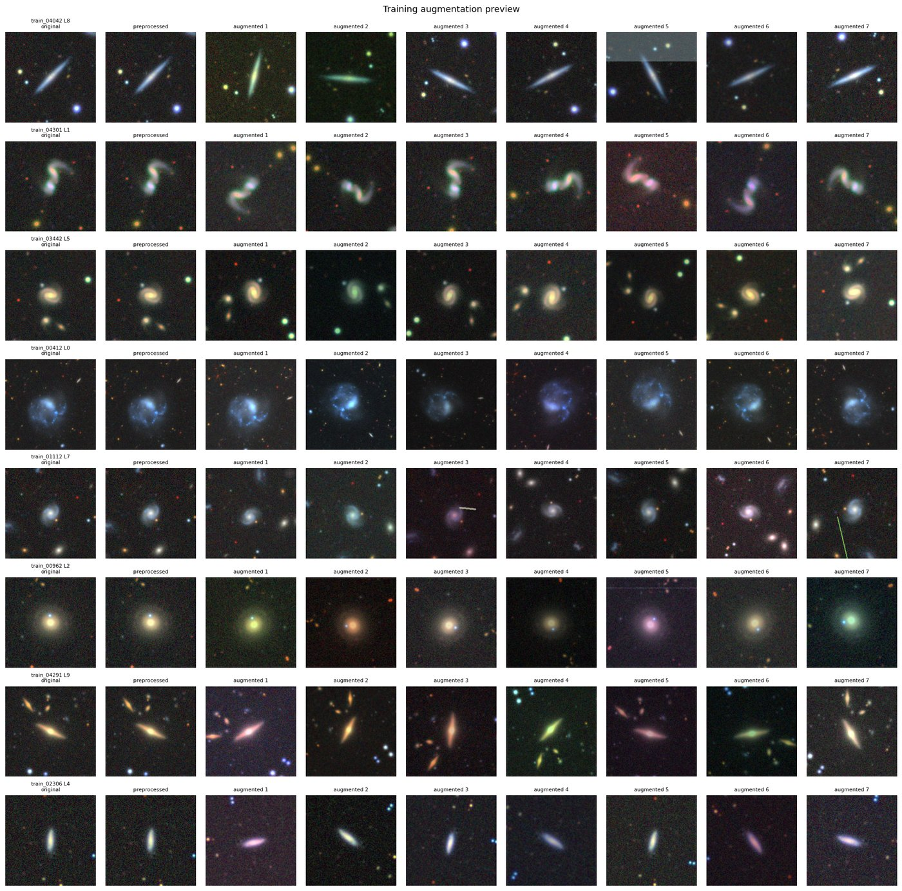

# 05 · Augmentation and transforms

Previous: [04 · Manifests and folds](04_MANIFESTS_AND_FOLDS.md) · Next: [06 · Sharing and loading data](06_SHARING_AND_LOADING_DATA.md)

Code: [spaghetti1/preprocessing/transforms.py](../spaghetti1/preprocessing/transforms.py). One `GalaxyTransform` object turns a uint8 image from disk into the float tensor the model receives.

## What happens to an image

| Order | Step | Training | Validation / test | Why |
| ---: | --- | :---: | :---: | --- |
| 1 | Random rotation 0–360°, mirror, scale 0.9–1.1, shift ≤ 4% | ✓ | | Morphology does not depend on orientation; reflection padding avoids black corners |
| 2 | Photometric corruption (table below) | ✓ | | Makes training images look like the corrupted test images |
| 3 | Synthetic artifact (15% of images) | ✓ | | The test set contains overlays that the training set barely has |
| 4 | Optional denoising (`denoise`) | ✓ | ✓ | Off by default; experiment switch |
| 5 | Optional background normalisation (`background_normalize`) | ✓ | ✓ | Off by default; experiment switch |
| 6 | Resize to `image_size` | ✓ | ✓ | Match the backbone's input size |
| 7 | Normalise with ImageNet mean and std | ✓ | ✓ | Pretrained backbones expect it |

Steps 4–7 are identical for training and test images, so the preprocessing at inference always matches training.

## Photometric corruptions (step 2)

The ranges come from fitting the 9 training/test duplicate pairs (see [03, section 6](03_PREPROCESSING.md#6--test-images-that-duplicate-a-training-image)). The test copies differ from their training images by global gains of 0.6–1.2 with offsets, per-channel gains down to 0.47, and red/blue channel mixing.

| Corruption | Probability | Range | `AugmentConfig` fields |
| --- | ---: | --- | --- |
| Red/blue channel mixing (purple and green casts) | 0.25 | up to 35% mixing | `p_channel_mix`, `max_channel_mix` |
| Per-channel gain (colour cast) | 0.5 | ×0.75–1.25 per channel | `p_channel_gain`, `channel_gain_range` |
| Brightness and contrast | 0.8 | gain ×0.6–1.25, offset −0.04…+0.05 | `p_intensity`, `gain_range`, `offset_range` |
| Gamma | 0.3 | 0.8–1.25 | `p_gamma`, `gamma_range` |
| Gaussian blur | 0.2 | σ 0.3–1.2 px | `p_blur`, `blur_sigma_range` |
| Gaussian noise (independent per channel) | 0.3 | σ 0.005–0.04 (≈ 1–10 on 0–255) | `p_noise`, `noise_sigma_range` |

Synthetic artifacts (step 3, `p_artifact`): one of a semi-transparent coloured rectangle, a thin coloured streak, a colour flood over one side, or a horizontal band with shifted brightness. Alien graphics are never added.



Regenerate this preview after any change: `python -m spaghetti1 augment-preview` (add `--background-normalize` or `--denoise bilateral` to see those options).

## Configuration objects

```python
from spaghetti1.preprocessing.transforms import AugmentConfig, PreprocessConfig, build_transforms

preprocess = PreprocessConfig(image_size=224, denoise="none", background_normalize=False)
augment = AugmentConfig(p_artifact=0.15)              # any field can be changed
train_transform, eval_transform = build_transforms(preprocess, augment)
tensor = train_transform(pixels)                      # pixels: uint8 array (256, 256, 3)
```

Both dataclasses are frozen. Record them with each experiment: `build_dataloaders` returns them in `loaders.config`.

## Experiment switches (off by default)

| Switch | What it does | Cost | Open question |
| --- | --- | --- | --- |
| `denoise="bilateral"` | Edge-preserving smoothing | ~2 ms per image | May help with noisy test images or blur faint arms |
| `denoise="nlm"` | Non-local means denoising | ~160 ms per image: too slow for on-the-fly training, precompute if it helps | Same as above, stronger |
| `background_normalize=True` | Maps each channel's background to 0.1 and the brightest 0.5% to 0.9 | Negligible | Removes brightness and background colour differences; may also remove useful colour information |

Keep a switch only if it improves validation weighted F1 (see [07](07_NEXT_STEPS.md)).

## Reproducibility

All random choices use PyTorch's RNG. `build_dataloaders` seeds the sampler and the workers (`seed_worker`). Set `torch.manual_seed(seed)` at the start of a run to reproduce the augmentation exactly.
