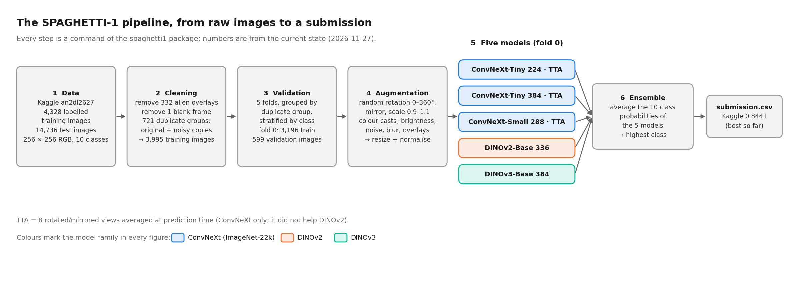
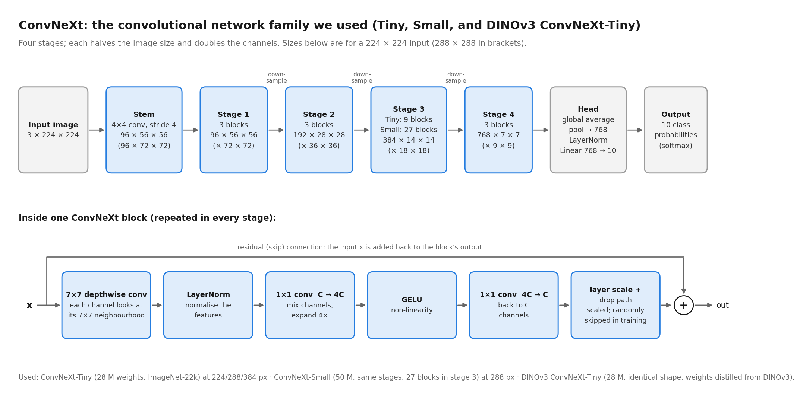
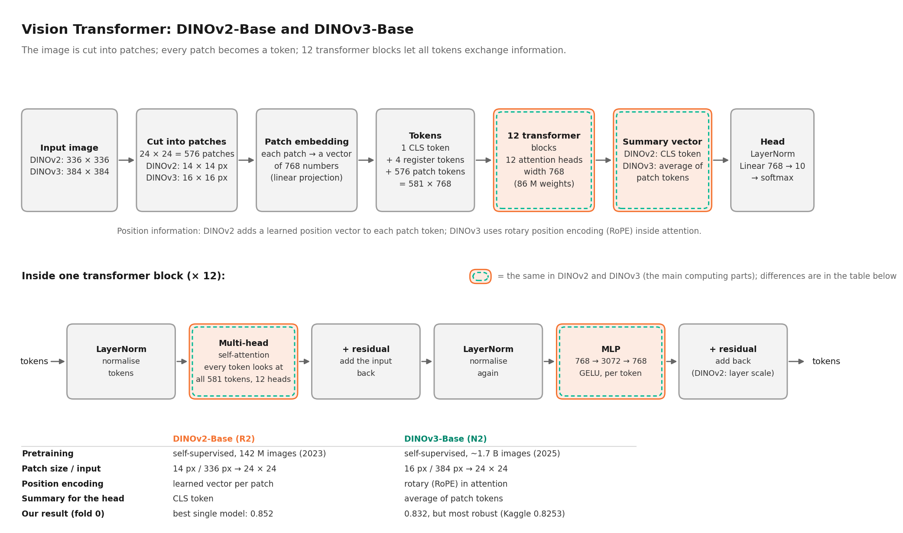
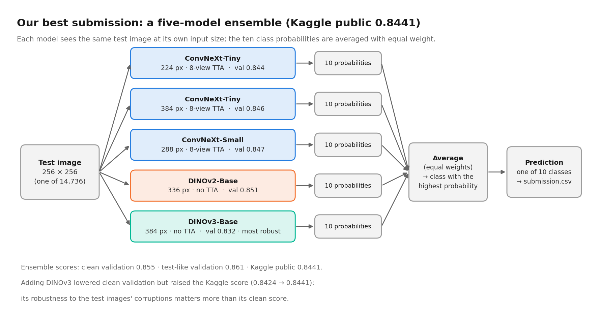
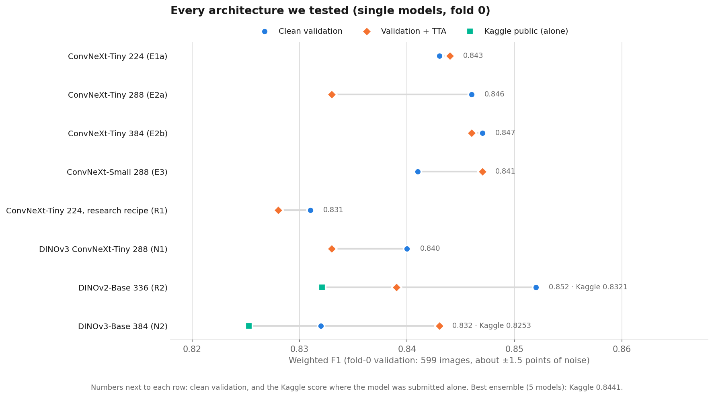

# 13 · Model architectures and the pipeline, in pictures

Previous: [12 · Concepts and techniques explained](12_CONCEPTS_EXPLAINED.md)

Five figures: the whole pipeline, the two network families we used (ConvNeXt and the Vision Transformer behind DINOv2/DINOv3), our best ensemble, and the scores of every architecture we tested. The architecture numbers (stages, channels, depths, patch grids, token counts) were read from the `timm` models themselves. Colours mark the model family in every figure: **blue = ConvNeXt**, **orange = DINOv2**, **aqua = DINOv3**.

The figures are generated by [experiments/render_architecture_figures.py](../experiments/render_architecture_figures.py). Re-run it after new results:

```bash
python experiments/render_architecture_figures.py
```

Terms such as *convolution*, *attention*, *TTA*, or *ensemble* are explained in [12](12_CONCEPTS_EXPLAINED.md).

## 1. The pipeline



From left to right:

1. **Data:** the official Kaggle data.
2. **Cleaning** ([03](03_PREPROCESSING.md)): alien overlays and the blank frame are removed, and copies of the same sky patch are grouped.
3. **Validation** ([04](04_MANIFESTS_AND_FOLDS.md)): five folds that keep copies together.
4. **Augmentation** ([05](05_AUGMENTATION_AND_TRANSFORMS.md)): random rotations and test-like corruptions.
5. **Five trained models.**
6. **The ensemble:** averages their probabilities and writes the submission.

## 2. ConvNeXt (convolutional network)



**What it does:** a convolutional network works like a stack of pattern detectors. The **stem** cuts the image into 4 × 4 pixel pieces. Then **four stages** each halve the image size and double the number of feature channels (96 → 192 → 384 → 768). Early stages see small details such as stars and edges; late stages see whole structures such as arms and bulges. The **head** averages the final 7 × 7 grid into one vector of 768 numbers and turns it into 10 class probabilities.

**Inside each block:**

* a 7 × 7 *depthwise* convolution (each channel looks at its neighbourhood);
* normalisation;
* two 1 × 1 convolutions that mix the channels;
* a **residual connection** that adds the block's input back to its output. This lets very deep networks train well.

**The three versions we used:**

| Version | Weights | Blocks per stage | Pretrained on | Input sizes tested |
| --- | ---: | --- | --- | --- |
| ConvNeXt-Tiny | 28 M | 3 · 3 · 9 · 3 | ImageNet-22k (labelled photos) | 224, 288, 384 |
| ConvNeXt-Small | 50 M | 3 · 3 · **27** · 3 | ImageNet-22k | 288 |
| DINOv3 ConvNeXt-Tiny | 28 M | 3 · 3 · 9 · 3 (identical shape) | distilled from DINOv3 (1.7 B web images) | 288 |

Same shape, different knowledge: the DINOv3 version has exactly the architecture of ConvNeXt-Tiny. Only the pretrained weights differ.

## 3. Vision Transformer (DINOv2 and DINOv3)



**What it does:** the image is cut into a **24 × 24 grid of patches** (576 patches). Each patch becomes a vector of 768 numbers, a **token**. One extra **CLS** token (a summary slot) and four **register** tokens (scratch space) are added, so there are 581 tokens. Twelve **transformer blocks** follow. In each block, **self-attention** lets every token look at all other tokens; this is how the model compares distant parts of a galaxy, such as both spiral arms. A small per-token network (**MLP**) then processes each token. Finally, one summary vector goes to the 10-class head.

**DINOv2 vs DINOv3:** the main computing parts are the same (12 blocks, 12 attention heads, width 768, about 86 M weights). The differences are listed in the table inside the figure:

* patch size 14 vs 16 pixels (the same 24 × 24 grid at 336 vs 384 px input);
* how patch positions are encoded: learned vectors vs rotary encoding (RoPE);
* how the summary vector is formed: the CLS token vs the average of all patch tokens.

## 4. Our best submission: the five-model ensemble



Each test image goes through five models, each at its own input size:

* the three ConvNeXt models average 8 rotated/mirrored views (TTA);
* DINOv2 and DINOv3 use the image once, because TTA did not help them.

The five sets of 10 probabilities are averaged with equal weight, and the highest class is the prediction. Kaggle public score: **0.8441**.

## 5. Every architecture we tested



The same numbers as a table:

| Model (run) | Clean validation | Validation + TTA | Kaggle public (alone) |
| --- | ---: | ---: | ---: |
| ConvNeXt-Tiny 224 (E1a) | 0.843 | 0.844 | |
| ConvNeXt-Tiny 288 (E2a) | 0.846 | 0.833 | |
| ConvNeXt-Tiny 384 (E2b) | 0.847 | 0.846 | |
| ConvNeXt-Small 288 (E3) | 0.841 | 0.847 | |
| ConvNeXt-Tiny 224, research recipe (R1) | 0.831 | 0.828 | |
| DINOv3 ConvNeXt-Tiny 288 (N1) | 0.840 | 0.833 | |
| DINOv2-Base 336 (R2) | **0.852** | 0.839 | 0.8321 |
| DINOv3-Base 384 (N2) | 0.832 | 0.843 | 0.8253 |
| **Best ensemble (5 models)** | 0.855 (test-like 0.861) | | **0.8441** |

**How to read it:** every single model lands between 0.83 and 0.85, and the differences are mostly within the ±1.5-point noise of the 599 validation images. TTA sometimes helps and sometimes hurts. The gain comes from combining different families, which make different mistakes, and from DINOv3's robustness to the test images' corruptions (see [10](10_RESEARCH_REVIEW_AND_PLAN.md)).
